# GeoSig – Cellular Signal Logger and Analytics

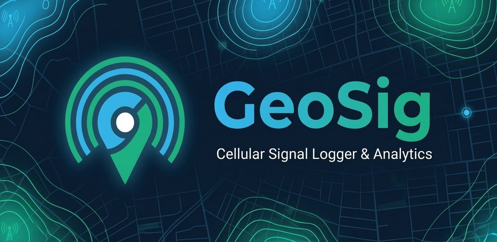{ .bw-geo-banner }

A 5G/LTE RF field-survey app and live coverage map: record cellular signal quality with GPS on any Android phone, analyse it on the spot, and see every survey on a shared web map.

[:material-map-marker-radius: Open the live coverage map](https://geosig.basigwireless.com){ .bw-btn .bw-btn--primary target="_blank" rel="noopener" }
[:material-android: Download the Android app (APK)](https://geosig.basigwireless.com/geosig.apk){ .bw-btn .bw-btn--outline }

Requires Android 7.0 or later. The app asks for Precise Location and Phone State permissions to record signal measurements with GPS fixes. <a href="https://geosig.basigwireless.com/privacy" target="_blank" rel="noopener">Privacy policy</a>

## How It Works

1:material-cellphone-wireless:<strong>Record</strong>The app logs 5G/LTE measurements with GNSS position continuously, even in the background.

2:material-chart-bell-curve:<strong>Analyse</strong>Built-in labs compute shadow fading, path loss, distance to the cell and handover health on the phone.

3:material-cloud-sync:<strong>Sync & map</strong>Readings sync to the GeoSig server and appear on the live web map for anyone to explore.

## App Features

:material-access-point-network:Live<strong>Live Signal Dashboard</strong>Serving-cell signal quality (RSRP, RSSI), cell identity (Cell ID/ECI, PCI, MCC-MNC, operator, network type), spectrum details (NR-ARFCN, DL/UL frequency, bandwidth), timing advance, GNSS fix and satellites, and dual-SIM support.

:material-speedometer:Live<strong>Latency & Throughput Probe</strong>Measures cellular latency (average, min/max ping), jitter and packet loss against a probe host, alongside the radio measurements.

:material-swap-horizontal-bold:Analyzer<strong>Neighbor & Handover Analyzer</strong>Serving-vs-neighbor RSRP timeline with handovers marked, handovers per minute, ping-pong detection, PCI collision and mod-3 interference checks, plus handover CSV export.

:material-chart-histogram:ShadowLab<strong>Shadow-Fading Lab</strong>Captures a 500-sample RSRP run and fits a Gaussian: mean, shadow σ, variance, P10/P50/P90, 90% fade margin and a log-normal interpretation of the clutter around you.

:material-radio-tower:ITU PropLab<strong>ITU Propagation Lab</strong>Applies the ITU-R M.2135 NLOS path-loss model to the measured RSRP to estimate distance to the cell (with a shadowing range), compares it with the LTE timing-advance distance, and plots path loss vs. distance. Carrier frequency is detected from the band; TX EIRP is adjustable.

:material-map-search:Map<strong>On-Phone Coverage Map</strong>Shows your survey trail, centres on your location, and uses logged GPS points to estimate cell-tower positions, with sectors and confidence for each tower.

:material-file-delimited:Settings<strong>Logging, Export & Sync</strong>Continuous background recording (resumes after reboot), drive-test readings and ShadowLab CSV exports, and sync to the central GeoSig server.

:material-key-variant:Tracking<strong>10-Digit Tracking Key</strong>Each phone gets a random 10-digit key. Enter it on the web map to follow that device's survey live, or generate a new key at any time.

## Screenshots

=== "Live"

    

    <figure markdown>
    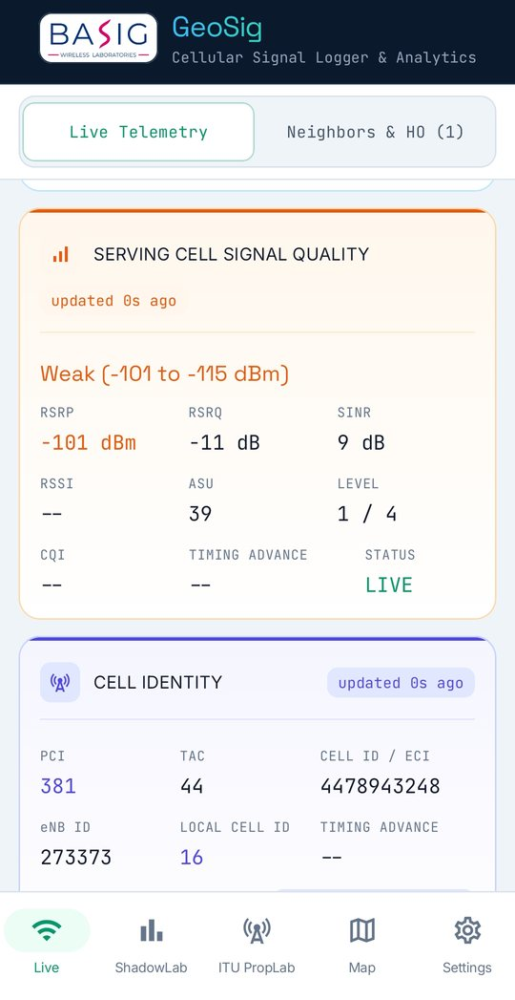{ loading=lazy }
    <figcaption>Serving-cell signal quality and cell identity</figcaption>
    </figure>
    <figure markdown>
    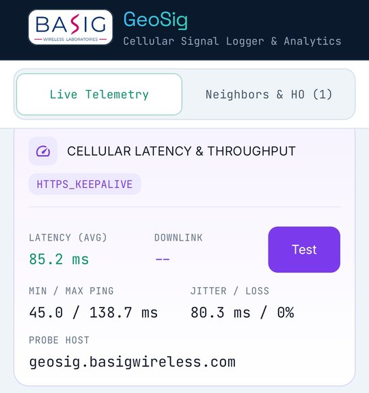{ loading=lazy }
    <figcaption>Cellular latency and jitter probe</figcaption>
    </figure>
    

=== "Neighbors & Handover"

    

    <figure markdown>
    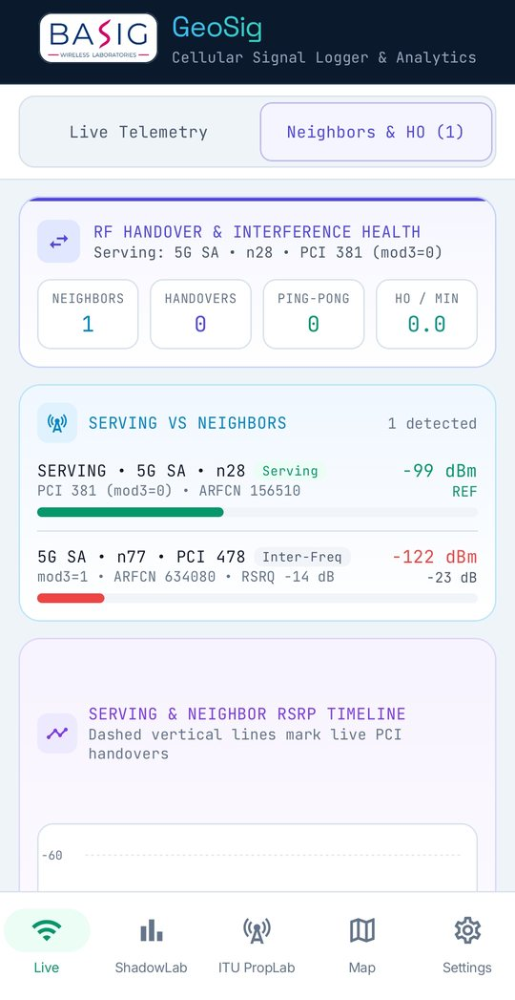{ loading=lazy }
    <figcaption>Handover health and serving vs. neighbor cells</figcaption>
    </figure>
    

=== "ShadowLab"

    

    <figure markdown>
    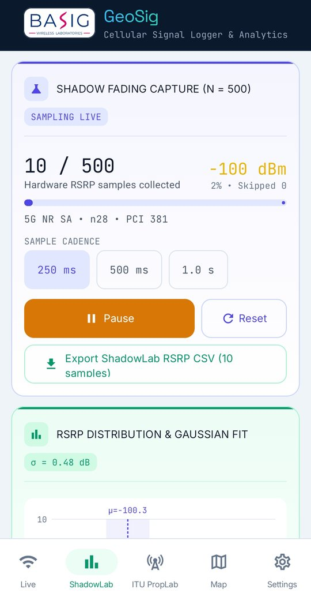{ loading=lazy }
    <figcaption>500-sample shadow-fading capture</figcaption>
    </figure>
    <figure markdown>
    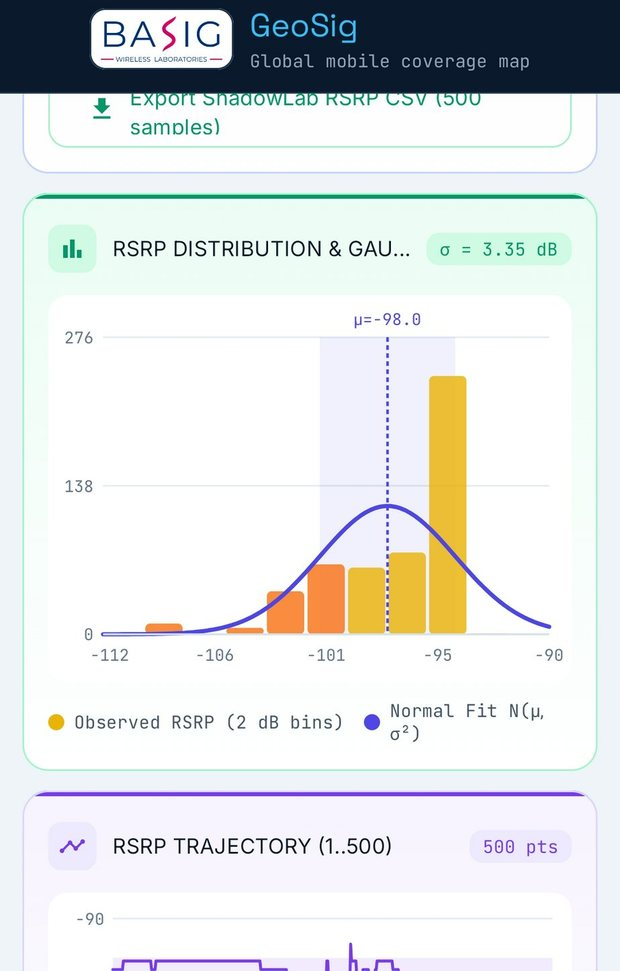{ loading=lazy }
    <figcaption>RSRP distribution with Gaussian fit</figcaption>
    </figure>
    <figure markdown>
    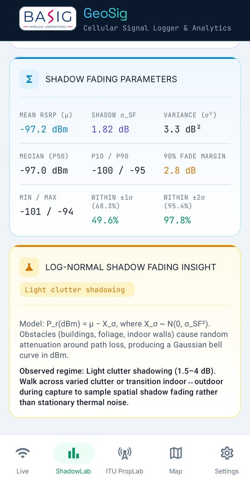{ loading=lazy }
    <figcaption>Shadow-fading parameters and insight</figcaption>
    </figure>
    

=== "ITU PropLab"

    

    <figure markdown>
    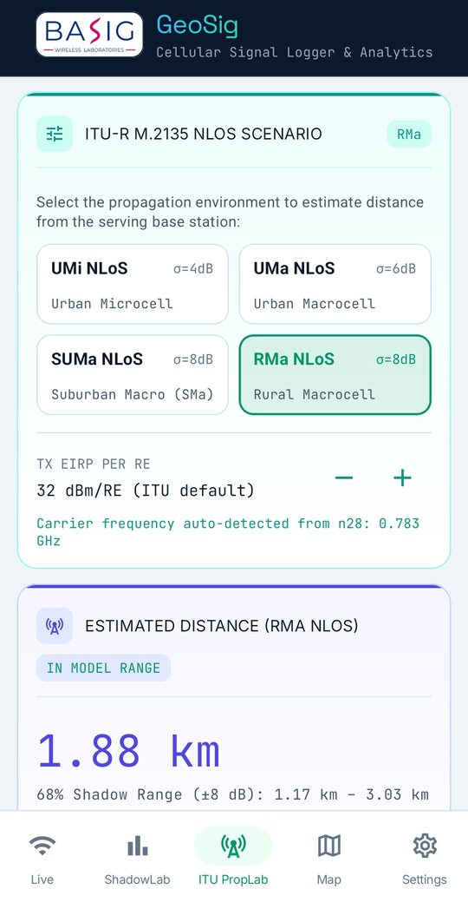{ loading=lazy }
    <figcaption>ITU-R M.2135 scenario and estimated distance</figcaption>
    </figure>
    <figure markdown>
    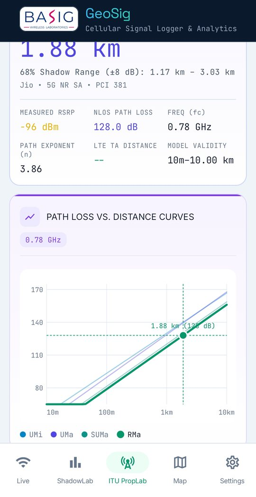{ loading=lazy }
    <figcaption>Path loss vs. distance curves</figcaption>
    </figure>
    <figure markdown>
    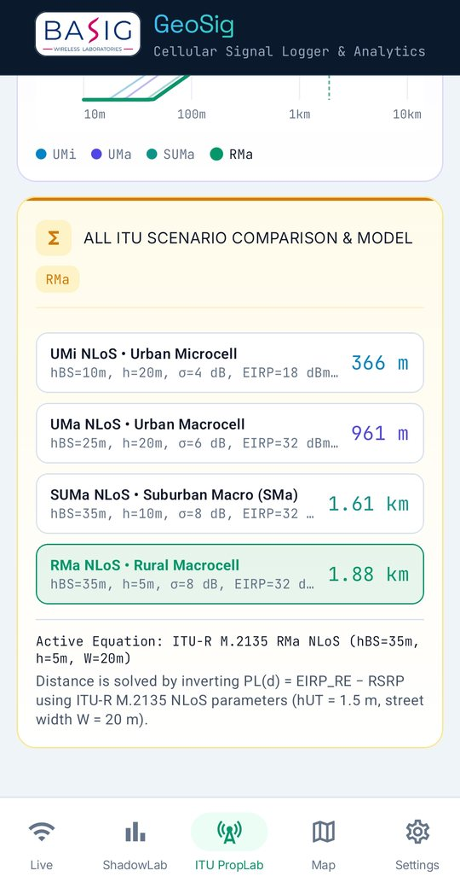{ loading=lazy }
    <figcaption>All ITU scenarios compared</figcaption>
    </figure>
    

=== "Settings & Export"

    

    <figure markdown>
    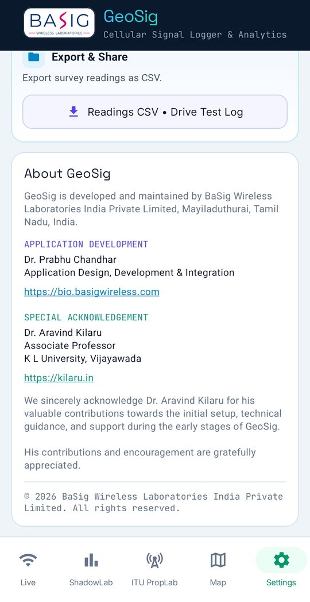{ loading=lazy }
    <figcaption>CSV export and About GeoSig</figcaption>
    </figure>
    

## Live Coverage Map (Web)

Open [geosig.basigwireless.com](https://geosig.basigwireless.com){ target="_blank" rel="noopener" } in any browser to see all synced readings.

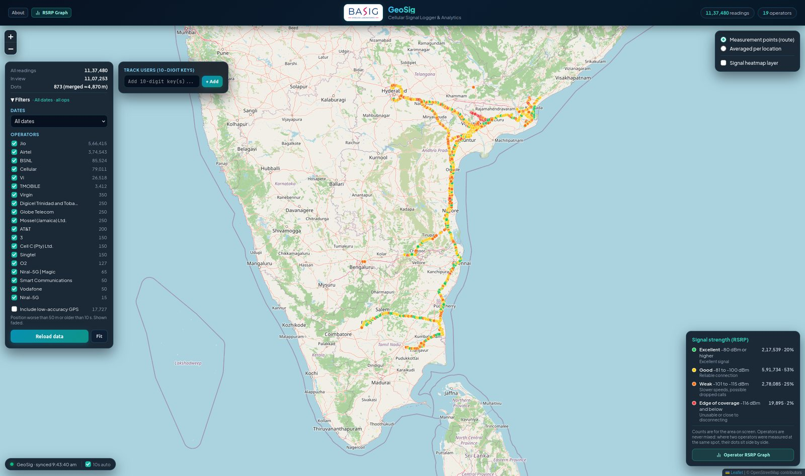{ .bw-geo-web loading=lazy }

- **Signal-strength colours:** Excellent (≥ −80 dBm), Good (−81 to −100), Weak (−101 to −115) and Edge of coverage (≤ −116 dBm RSRP)
- **Filters:** date range (today, last 7 days or custom), operator, and optional low-accuracy GPS points
- **Live tracking:** follow one or more phones by their 10-digit keys; route and heatmap layers
- **Charts:** operator-wise RSRP distribution and radio-technology breakdown
- **Always current:** the map refreshes automatically every 10 seconds

GeoSig for your campus or network

<h2 class="bw-h2">Coverage surveys, drive tests and training</h2>

Email us about deploying GeoSig for your institution, or using it in a lab course or workshop.

<a class="bw-btn bw-btn--primary" href="mailto:info@basigwireless.com">info@basigwireless.com</a>

