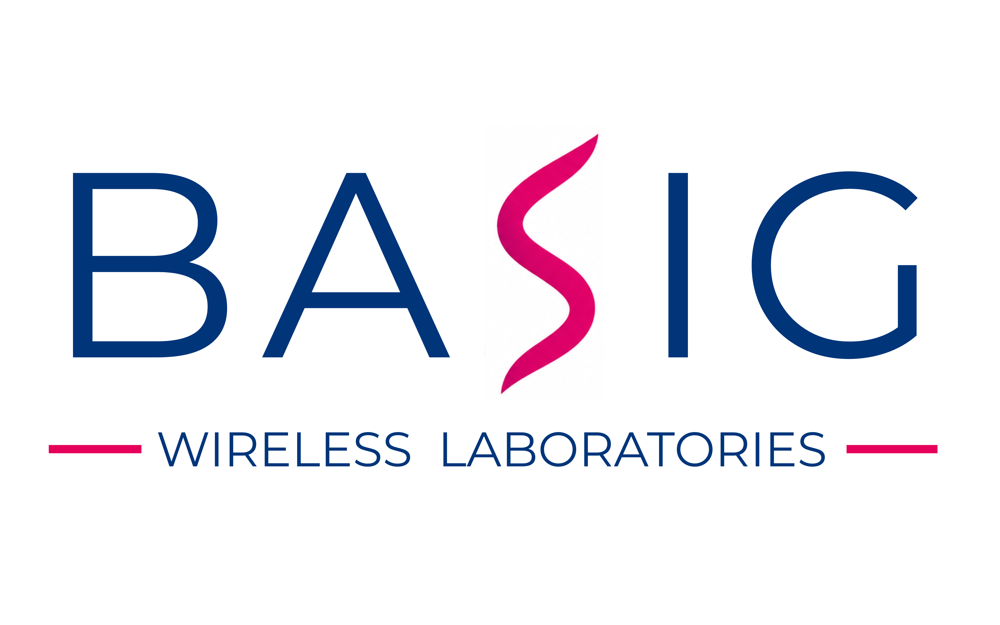
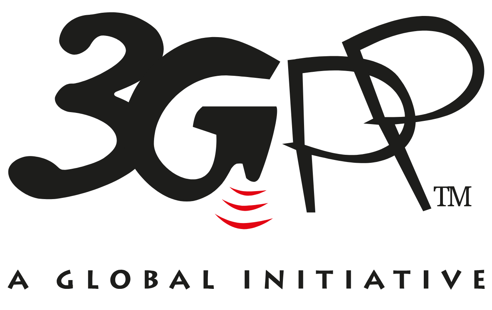
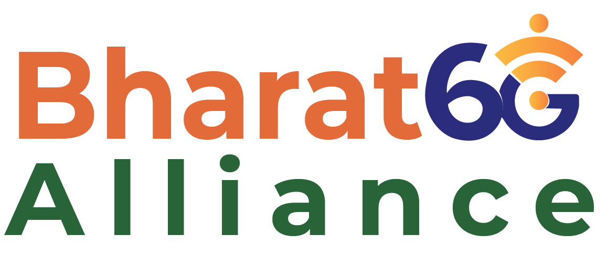

# BaSig Wireless

  

### AI-Driven Wireless Systems  
5G - 6G - SDR - Edge Intelligence

---

## About BaSig Wireless

BaSig Wireless develops next-generation wireless communication systems combining:

- 5G & 6G Technologies  
- Software Defined Radio (SDR)  
- AI for Wireless Communication  
- Research & Product Development

[Learn more about us](about/company.md)

---

## Standards & Industry Alliances

BaSig Wireless is a member of leading telecommunications standardisation organisations and industry alliances, actively engaging with the global wireless technology ecosystem and India's 6G vision.

| **3GPP** | **TSDSI** | **Bharat 6G Alliance** |
|:---:|:---:|:---:|
|  |  |  |
| Global mobile telecommunications standards development. | Telecommunications Standards Development Society, India. | India's 6G technology research and industry ecosystem. |
| [Official Website](https://www.3gpp.org/) | [Official Website](https://tsdsi.in/) | [Official Website](https://bharat6galliance.com/bharat6G/) |

---

## Core Focus Areas

- 5G Advanced and 6G Technologies  
- Software Defined Radio and Indigenous Radio Technologies
- AI-Native Wireless Communications  
- Drone & Vehicular Communications  
- IoT & Network Security  
- Spectrum Management and Sharing
- Wireless Standards and Specifications

---

## Products

Our platforms are designed for academic institutions, R&D labs, and industry.

- **5Nines Radio** – End‑to‑End 4G/5G Testbed
- **BaSig5G** - End-to-End 5G Network Software in Python
- **Deep Radio** – AI‑Driven Wireless System  
- **Wi‑Guy** – SDR Platform for Wireless Learning  
- **5NR‑NSMEC** – 5G Network Slicing & MEC Emulator  
- **IoT Security Testbed**  
- **5G Enabled E‑Vehicle**  

[Explore all products](products/index.md)

---

## Research

Our research spans fundamental and applied areas in next‑generation wireless communications.

- 5G Use Cases  
- 5G Security    
- AI for Wireless  
- Spectrum Management  
- IoT Security  

[View research areas](research/index.md)

---

## Publications

Our work is published in IEEE journals and international conferences.

[Publications](publications/index.md) 

---

## Chandhar Research Press

An independent imprint associated with BaSig for research, books, and standards. 
 
[More about Chandhar Research Press](press/index.md)

---

## Workshops & Training

We conduct hands‑on workshops, faculty development programs, and industry training.

- 5G Hands‑On Workshops
- Deep Learning for Wireless  
- Academic FDPs  
- Customized Industry Training  

[Workshops & Training](workshops/)

---

## Internships & Collaboration

We offer internships and research collaboration opportunities for:

- UG / PG Students  
- PhD Scholars  
- Faculty Members  
- Industry Professionals  

[Internships](internships/)  

---

## Quick Links

- [JEWS - Journal of Experimental Wireless Systems](https://jewsjournal.org)
- [YESDR Standard](https://yesdr-standard.org)
- [GitHub – BaSig Wireless](https://github.com/basigwireless)
- [Kaggle – BaSig Wireless](https://www.kaggle.com/chandharlabs)
- [Youtube - BaSig Wireless](https://www.youtube.com/@BaSigWireless/videos)

---

!!! info "Contact Us"
    Interested in collaboration, training, research, or product deployment?  
    We’d be happy to hear from you.

    Email: **info@basigwireless.com**    

