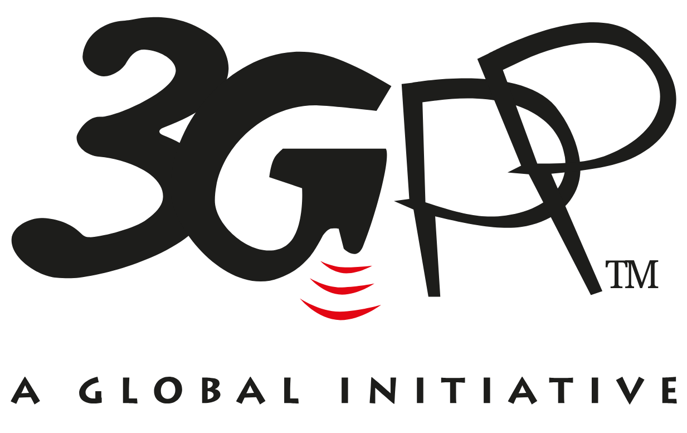
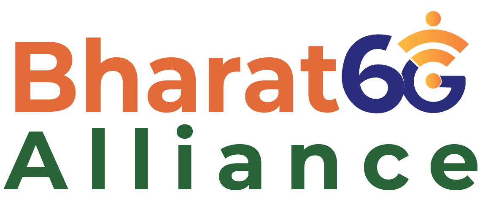
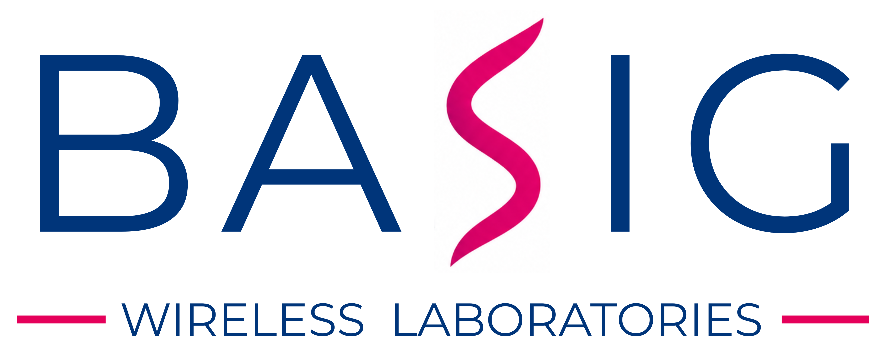

<section class="bw-hero">
<canvas class="bw-hero__waves" aria-hidden="true"></canvas>

BaSig Wireless Laboratories

<h1 class="bw-hero__title bw-reveal">Research, Innovation &amp; Product Development in Wireless and SDR Systems</h1>

From 5G &amp; 6G to software-defined radio and AI-native wireless, we turn research into testbeds and products for academia, R&amp;D labs and industry.

<a class="bw-btn bw-btn--primary" href="products/">Explore products</a>
<a class="bw-btn bw-btn--ghost" href="about/contact/">Get in touch</a>

<ul class="bw-chips bw-reveal">
<li>5G &amp; 6G</li><li>Software Defined Radio</li><li>AI for Wireless</li><li>Research &amp; Products</li>
</ul>

</section>

<section class="bw-members bw-reveal">

Member of leading standards bodies &amp; alliances

</section>

<section class="bw-section bw-about" markdown>

About us

<h2 class="bw-h2">Wireless Technology, from Research to Product</h2>

BaSig Wireless is a member of leading telecommunications standardisation organisations and industry alliances, actively engaging with the global wireless technology ecosystem and India's 6G vision.

<a class="bw-link" href="about/company/">Learn more about us :material-arrow-right:</a>

</section>

<section class="bw-section" markdown>

Core focus areas

<h2 class="bw-h2">What We Work On</h2>

:material-signal-5g:5G Advanced and 6G Technologies

:material-sine-wave:Software Defined Radio and Indigenous Radio Technologies

:material-brain:AI-Native Wireless Communications

:material-quadcopter:Drone &amp; Vehicular Communications

:material-shield-lock:IoT &amp; Network Security

:material-chart-bell-curve:Spectrum Management and Sharing

:material-scale-balance:Wireless Standards and Specifications

</section>

<section class="bw-section bw-section--tint" markdown>

Products

<h2 class="bw-h2">Platforms for Academia, R&amp;D Labs and Industry</h2>

<a class="bw-card bw-reveal" href="products/5-nines-radio/">:material-radio-tower:<strong>5Nines Radio®</strong>End-to-end 4G/5G testbed for URLLC, eMBB and mMTC research.View product :material-arrow-right:</a>

<a class="bw-card bw-reveal" href="products/5Nines%20Core/">:material-server-network:<strong>5Nines Core</strong>A high-reliability core network for 5G testbeds.View product :material-arrow-right:</a>

<a class="bw-card bw-reveal" href="products/basig5g/">:material-language-python:<strong>BaSig5G</strong>End-to-end 5G network software in Python.View product :material-arrow-right:</a>

<a class="bw-card bw-reveal" href="products/deep-radio/">:material-brain:<strong>Deep Radio®</strong>Deep learning–enabled wireless testbed for AI-driven PHY and MAC research.View product :material-arrow-right:</a>

<a class="bw-card bw-reveal" href="products/wi-guy/">:material-access-point-network:<strong>Wi-Guy®</strong>SDR platform for learning and experimenting with wireless fundamentals.View product :material-arrow-right:</a>

<a class="bw-card bw-reveal" href="products/loiter/">:material-quadcopter:<strong>Loiter®</strong>5G-enabled drone platform for UAV communications and edge-assisted autonomy.View product :material-arrow-right:</a>

<a class="bw-card bw-reveal" href="products/iot-security-testbed/">:material-shield-lock:<strong>IoT Security Testbed</strong>Security, privacy and resilience analysis in IoT networks.View product :material-arrow-right:</a>

<a class="bw-card bw-reveal" href="products/5nr-nsmec/">:material-lan:<strong>5NR-NSMEC</strong>5G network slicing and multi-access edge computing (MEC) emulator.View product :material-arrow-right:</a>

<a class="bw-card bw-reveal" href="products/5g-ev/">:material-car-electric:<strong>5G Enabled E-Vehicle</strong>5G-integrated electric vehicle platform for V2X and smart mobility research.View product :material-arrow-right:</a>

<a class="bw-btn bw-btn--outline" href="products/">Explore all products</a>

</section>

<section class="bw-section" markdown>

Research

<h2 class="bw-h2">Fundamental and Applied Research in Next-Generation Wireless</h2>

<a class="bw-pill-card bw-reveal" href="research/areas/5g-use-cases/">:material-cellphone-wireless: 5G Use Cases</a>

<a class="bw-pill-card bw-reveal" href="research/areas/5g-security/">:material-shield-lock: 5G Security</a>

<a class="bw-pill-card bw-reveal" href="research/areas/5g-drones/">:material-quadcopter: 5G Enabled Drones</a>

<a class="bw-pill-card bw-reveal" href="research/areas/dl-wireless/">:material-brain: Deep Learning for Wireless</a>

<a class="bw-pill-card bw-reveal" href="research/areas/spectrum-management/">:material-chart-bell-curve: Spectrum Management</a>

<a class="bw-pill-card bw-reveal" href="research/areas/iot-security/">:material-router-wireless: IoT Security</a>

</section>

<section class="bw-section bw-split" markdown>
<a class="bw-panel bw-reveal" href="publications/">
:material-file-document-multiple:
Publications
Our work is published in IEEE journals and international conferences, alongside books on hands-on wireless systems.
Browse publications :material-arrow-right:
</a>
<a class="bw-panel bw-reveal" href="press/">
:material-book-open-page-variant:
Chandhar Research Press
An independent imprint associated with BaSig for research, books, and standards, including JEWS and the YESDR standard.
More about the press :material-arrow-right:
</a>
</section>

<section class="bw-section bw-split" markdown>

:material-school:
Workshops &amp; Training
Hands-on workshops, faculty development programs and industry training.
<ul class="bw-checks"><li>5G Hands-On Workshops</li><li>Deep Learning for Wireless</li><li>Academic FDPs</li><li>Customized Industry Training</li></ul>
<a class="bw-link" href="workshops/">Workshops &amp; training :material-arrow-right:</a>

:material-account-group:
Internships &amp; Collaboration
Internships and research collaboration opportunities for:
<ul class="bw-checks"><li>UG / PG Students</li><li>PhD Scholars</li><li>Faculty Members</li><li>Industry Professionals</li></ul>
<a class="bw-link" href="internships/">Internships :material-arrow-right:</a>

</section>

<section class="bw-section bw-links bw-reveal" markdown>

Quick links

<a href="https://jewsjournal.org" target="_blank" rel="noopener">:material-newspaper-variant-outline: JEWS Journal</a>

<a href="https://yesdr-standard.org" target="_blank" rel="noopener">:material-certificate: YESDR Standard</a>

<a href="https://github.com/basigwireless" target="_blank" rel="noopener">:fontawesome-brands-github: GitHub</a>

<a href="https://www.kaggle.com/chandharlabs" target="_blank" rel="noopener">:fontawesome-brands-kaggle: Kaggle</a>

<a href="https://www.youtube.com/@BaSigWireless/videos" target="_blank" rel="noopener">:fontawesome-brands-youtube: YouTube</a>

</section>

<section class="bw-cta bw-reveal">
<canvas class="bw-hero__waves bw-hero__waves--soft" aria-hidden="true"></canvas>

<h2>Interested in collaboration, training, research or product deployment?</h2>

We'd be happy to hear from you.

<a class="bw-btn bw-btn--primary" href="mailto:info@basigwireless.com">info@basigwireless.com</a>

</section>

