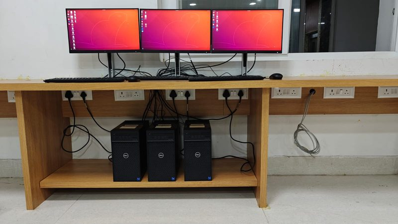
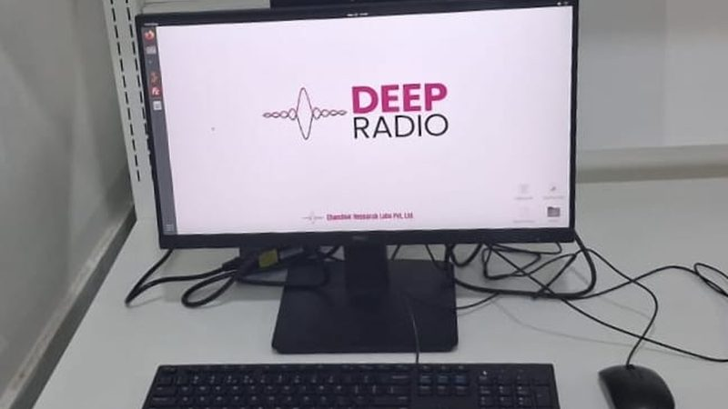
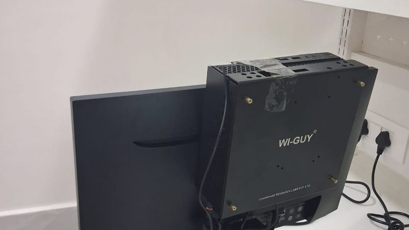
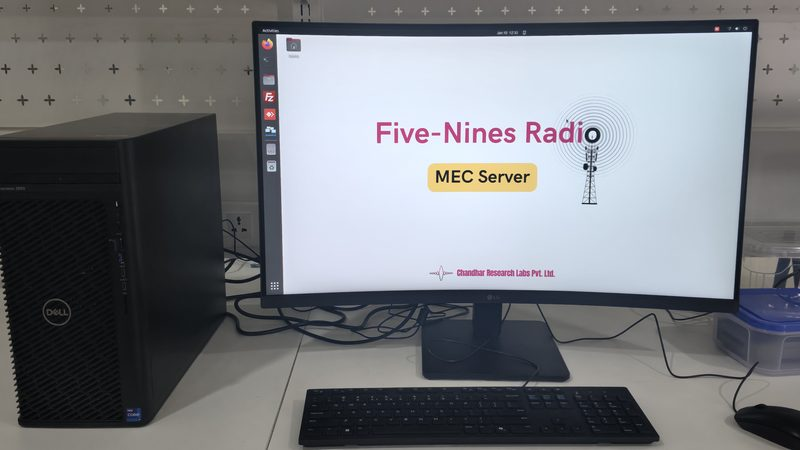

# Products

BaSig develops research‑grade platforms and testbeds for wireless communications, 5G/6G systems, IoT, and AI‑driven networks, designed for academic institutions, R&D labs and industry.

:material-school: Academic institutions :material-flask-outline: R&amp;D labs :material-factory: Industry

<a class="bw-product" href="5-nines-radio/">5G Testbed<strong>5Nines Radio®</strong>A high‑reliability end‑to‑end 5G testbed for URLLC, eMBB and mMTC research.View product :material-arrow-right:</a>

<a class="bw-product" href="5Nines%20Core/">:material-server-network:5G Core<strong>5Nines Core</strong>A high‑reliability core network for 5G testbeds.View product :material-arrow-right:</a>

<a class="bw-product" href="basig5g/">:material-language-python:Software<strong>BaSig5G</strong>End-to-end 5G network software in Python.View product :material-arrow-right:</a>

<a class="bw-product" href="deep-radio/">AI Testbed<strong>Deep Radio®</strong>A deep learning–enabled wireless testbed for AI‑driven PHY and MAC research.View product :material-arrow-right:</a>

<a class="bw-product" href="wi-guy/">SDR Platform<strong>Wi‑Guy®</strong>An SDR‑based platform for learning and experimenting with wireless fundamentals.View product :material-arrow-right:</a>

<a class="bw-product" href="loiter/">:material-quadcopter:5G Drone<strong>Loiter®</strong>A 5G‑enabled drone platform for UAV communications and edge‑assisted autonomy.View product :material-arrow-right:</a>

<a class="bw-product" href="iot-security-testbed/">:material-shield-lock:Testbed<strong>IoT Security Testbed</strong>A testbed for security, privacy and resilience analysis in IoT networks.View product :material-arrow-right:</a>

<a class="bw-product" href="5nr-nsmec/">Emulator<strong>5NR‑NSMEC</strong>5G network slicing and multi‑access edge computing (MEC) emulator.View product :material-arrow-right:</a>

<a class="bw-product" href="5g-ev/">:material-car-electric:V2X Platform<strong>5G Enabled E‑Vehicle</strong>A 5G‑integrated electric vehicle platform for V2X and smart mobility research.View product :material-arrow-right:</a>

To buy

<h2 class="bw-h2">Purchase, pricing and demos</h2>

Email our sales team and mention the product name in your message.

<a class="bw-btn bw-btn--primary" href="mailto:sales@basigwireless.com">sales@basigwireless.com</a>

