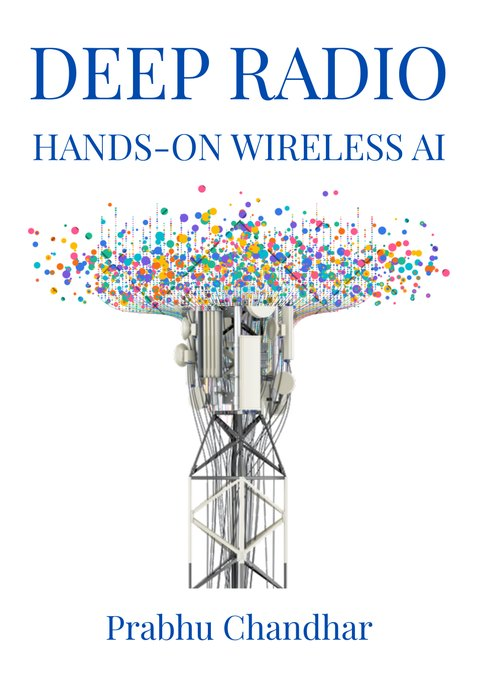
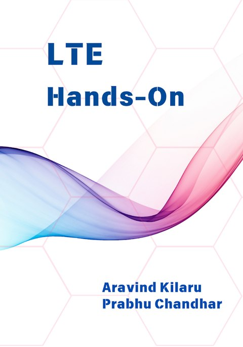

# Books

Hands-on books on wireless systems, published by Chandhar Research Press.

### Deep Radio: Hands-On Wireless AI

Prabhu Chandhar  
Chandhar Research Press, 2026  
**ISBN:** 978‑81‑982943‑0‑2

[About the book :material-arrow-right:](../press/deep-radio-hands-on.md){ .bw-link }

### YESDR: Your Extensible Software-Defined Radio

Prabhu Chandhar  
Chandhar Research Press, 2026  
**ISBN:** 978-81-982943-6-4

[About the book :material-arrow-right:](../press/yesdr-hands-on.md){ .bw-link }

### 5G NR Hands-On

Aravind Kilaru, Prabhu Chandhar  
Chandhar Research Press, 2025  
**ISBN:** 978‑81‑982943‑5‑7

[About the book :material-arrow-right:](../press/5g-nr-hands-on.md){ .bw-link }

### LTE Hands-On

Aravind Kilaru, Prabhu Chandhar  
Chandhar Research Press, 2024  
**ISBN:** 978‑81‑982943‑9‑5

[About the book :material-arrow-right:](../press/lte-hands-on.md){ .bw-link }

