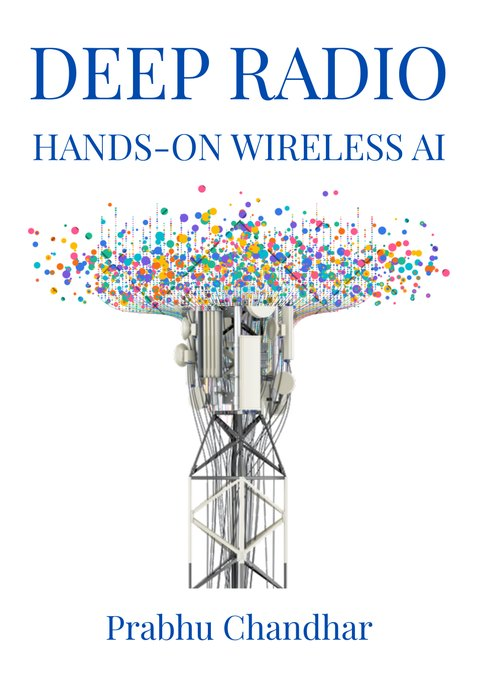
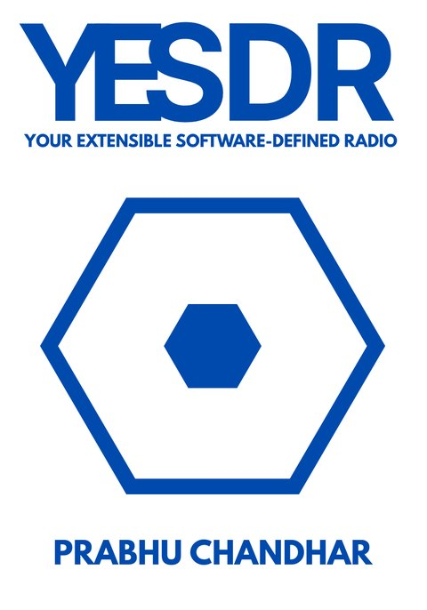
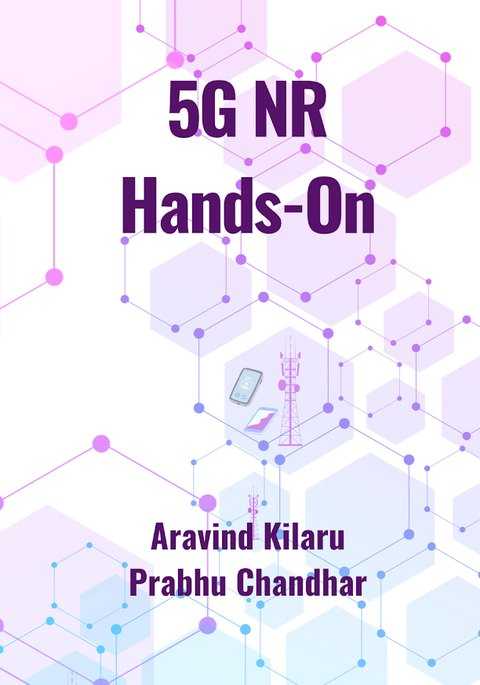
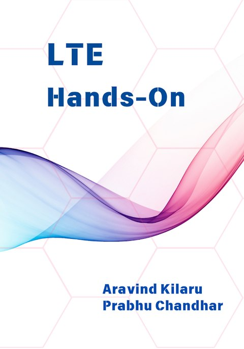

# Publications

Our work is published in IEEE journals and international conferences, alongside books on hands-on wireless systems and a patent.

## Books

<a class="bw-book" href="../press/deep-radio-hands-on/"><strong>Deep Radio: Hands‑On Wireless AI</strong>2026</a>

<a class="bw-book" href="../press/yesdr-hands-on/"><strong>YESDR: Your Extensible Software Defined Radio</strong>2026</a>

<a class="bw-book" href="../press/5g-nr-hands-on/"><strong>5G NR Hands‑On</strong>2025</a>

<a class="bw-book" href="../press/lte-hands-on/"><strong>LTE Hands‑On</strong>2024</a>

<!-- pubs:stats -->

<a class="bw-card" href="books-publications/">:material-book-open-page-variant:<strong>Books</strong><!-- pubs:count:books --> hands-on books from Chandhar Research Press.View all :material-arrow-right:</a>

<a class="bw-card" href="journal-publications/">:material-file-document-multiple:<strong>Journal Publications</strong><!-- pubs:count:journal --> articles in IEEE and international journals.View all :material-arrow-right:</a>

<a class="bw-card" href="conference-publications/">:material-presentation:<strong>Conference Publications</strong><!-- pubs:count:conference --> papers at IEEE and international conferences.View all :material-arrow-right:</a>

<a class="bw-card" href="patents-and-more/">:material-certificate:<strong>Patents & More</strong>A patent, master's thesis supervision and blog posts.View all :material-arrow-right:</a>

## Latest Papers

<!-- pubs:latest -->

[:material-school: Google Scholar profile](https://scholar.google.co.in/citations?user=NL_MEEsAAAAJ&hl=en){ .bw-btn .bw-btn--outline target="_blank" rel="noopener" }
