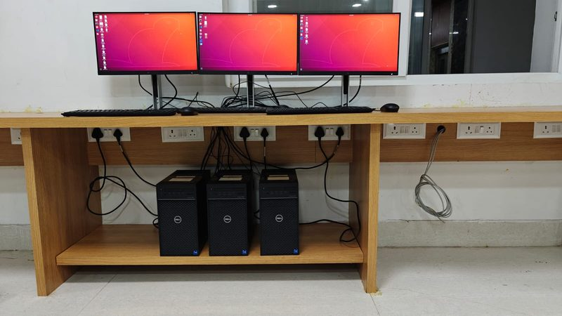
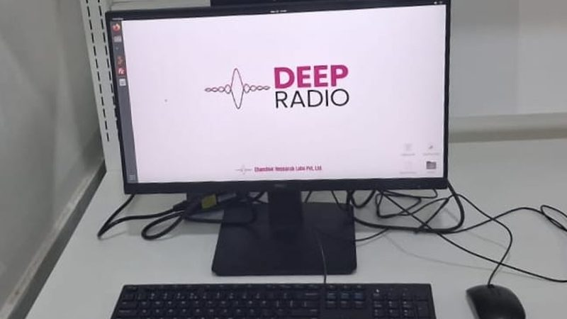

# Workshops

Hands‑on, research‑oriented workshops in 5G, AI‑driven wireless systems and advanced communication technologies.

For students, faculty, researchers and industry professionals. Participants work directly on real testbeds and SDR platforms.

<a class="bw-product" href="5g-hands-on/">3–5 days · Hands-on<strong>5G Hands‑On</strong>A practical, end‑to‑end workshop on 5G networks covering RAN, Core, network slicing, MEC and real testbeds.Workshop details :material-arrow-right:</a>

<a class="bw-product" href="dl-wireless/">3–5 days · Lab-oriented<strong>Deep Learning for Wireless</strong>An intensive hands‑on programme applying machine learning and deep learning to wireless communication systems.Workshop details :material-arrow-right:</a>

## Recently Delivered

<!-- workshops:latest -->

[All workshops, talks and tutorials :material-arrow-right:](../talks/workshops.md){ .bw-link }

Organise a workshop

<h2 class="bw-h2">Workshops, FDPs and custom training</h2>

Email us with the topic, expected duration and audience (UG / PG / Faculty / Industry).

<a class="bw-btn bw-btn--primary" href="mailto:info@basigwireless.com">info@basigwireless.com</a>

